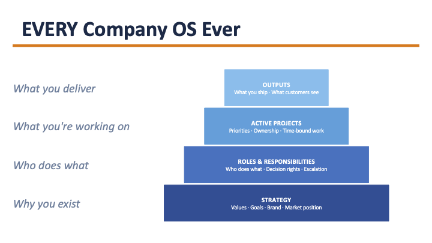
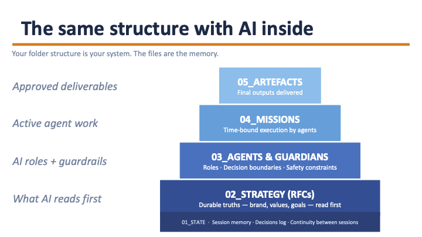

# BoS OS Start

The BoS OS helps you get clear on how your company actually works: how decisions get made, who owns what, and what you're optimising for. It gives AI a governed place inside that system.

Most companies add AI tools on top of an operating system nobody has written down. Strategy lives in the founder's head. Roles blur. Decisions don't stick. AI amplifies whatever's already there. Clarity becomes velocity; muddle becomes noise.

These three skills fix the foundation first, then put it to work.

**Current version: v2.6.0**. [What's new](CHANGELOG.md)

---

## What's here

This repo contains three skills that activate your company BoS OS:

**Bootstrap** models your BoS OS from public information. It produces a first draft of your strategy layer, roles, and decision governance. Workshop then turns that into your first mission, so the BoS OS has a real job from day one. Think of it as the AI doing its homework on your company before you meet.

**Workshop** helps you refine what Bootstrap produced. It works with your insider knowledge, challenging assumptions, sharpening priorities, and turning the skeleton into something that reflects how you actually run the business. As you work through it, the AI starts to understand your strategic goals, identify gaps, and surface opportunities and threats specific to your business.

**Run** is the coordination layer for operating your BoS OS day to day. Three agents (Mission Shaper, Agent Planner, Delivery Manager) take a rough idea and turn it into a staffed, running mission. Use this once Bootstrap and Workshop have done their job.

Use them in sequence. Bootstrap first, Workshop second, Run when you're ready to operate.

> **In plain English:** Bootstrap creates; Workshop refines; Run operates.

---

See the full [CHANGELOG](CHANGELOG.md) for what's new and upgrade instructions.

---

## How it works

Every company already has an operating system. Most just don't know what's in it.

The BoS OS maps that structure, then gives AI a governed place inside it.

Your folder structure is your system. The files are the memory.

---

## Getting started

You need two things. An AI that can read a folder of files, and a folder on your computer that you own. The BoS OS is plain text files in that folder. You hold the data, and any AI you give access to the folder reads the same instructions. The [Quickstart](QUICKSTART.md) is the short version.

**Step 1. Download the skills**

Go to the [latest release](https://github.com/BoSMark/BoS_OS_Start/releases/latest) and download:
- `agent-os-bootstrap.skill`
- `agent-os-workshop.skill`
- `agent-os-run.skill` *(optional: install after Bootstrap and Workshop are working)*

These are ready-to-upload files. **Do not unzip them.** If your AI does not take skill files, see Step 4.

**Step 2. Make your folder**

Make an empty folder on your computer, inside Dropbox, Google Drive or similar, so it is backed up. Bootstrap creates a folder called "[your company name] BoS OS" inside it. Everything the BoS OS produces is saved there.

**Step 3. Give your AI access to the folder**

The screens differ between tools and change often, so this guide does not list them. If you cannot find the option, ask your AI "How do I connect you to a folder on my computer?" and follow what it tells you. The table shows the routes we know of.

| Route | What you do | Reads your folder | Writes to your folder |
|-------|-------------|-------------------|-----------------------|
| Claude desktop app | Add the folder to a project, then add the skills | Yes | Yes |
| ChatGPT with the folder attached | Attach the folder to a project in the ChatGPT app. In the project instructions, write "Read CLAUDE.md in this folder in full before doing anything else." | Yes | Yes |
| ChatGPT on the web, project with uploaded files | Upload the files and paste the same line into the project instructions | A copy only. Upload again after any change | No |
| Coding tools such as Codex, Cursor and Copilot's coding agent | Open the folder. They look for `AGENTS.md`, which Bootstrap writes | Yes | Yes |
| Gemini CLI | Open the folder and ask it to read `CLAUDE.md` first | Yes | Yes |
| Any chat-only AI | Paste the skill as your first message, then copy the results into your folder yourself | No | No |

ChatGPT works with the BoS OS on both of its routes. We have run the BoS OS in a ChatGPT project with the folder attached, and ChatGPT saves what it produces into that folder. We have also run it in ChatGPT on the web, where ChatGPT reads copies of your files, so upload them again after any change. We have run it in Claude, in Codex and in a chat-only AI. We have not run Cursor, Copilot's coding agent or Gemini CLI. The table follows each tool's own documentation for those rows, so treat them as a starting point and expect the screens to change.

**Step 4. Add the skills**

Where your AI takes skill files, upload each one as you downloaded it. Where it does not, open `agent-os-bootstrap/SKILL.md` in this repo and paste its contents as your first message.

**Step 5. Run Bootstrap**

Start a chat in the place where your AI can see your folder. Then type this exactly:

> **Bootstrap my BoS OS**

It will ask for your company name and build your BoS OS draft from there.

---

## A note on strategy documents

Your BoS OS is built around strategy documents. Each one covers a distinct area of your business: values, growth, product, decision governance, and more. They are living documents, meant to evolve as you learn more about what the system can do. Bootstrap produces a first draft of each from public information. Workshop helps you enrich them with what only you know.

---

## Your first steps after Bootstrap

Bootstrap produces a lot. Don't try to process it all at once. Read the summary Bootstrap gives you at the end of the session first, it tells you exactly what to do next. Then:

1. Read your CLAUDE.md and correct anything that's wrong, paying particular attention to tone and terminology
2. Read your Values strategy document and adjust it to sound like you, not like a consultant wrote it
3. Pick one strategy document that covers your biggest current challenge and start with Workshop on that document alone
4. Ignore everything else for now. The rest will still be there

The system is designed to be lived in gradually, not consumed in one sitting.

If Bootstrap gave you something useful, a star on this repo helps the next founder find it too.

---

## Upgrading from an earlier version

If you installed the toolkit at a Business of Software conference or from an earlier release, v2.6.0 adds operating sections to the CLAUDE.md template, a one-line `AGENTS.md` pointer and new role stub fields. Your existing files are safe, the migration is additive.

See [CHANGELOG.md](CHANGELOG.md) for the upgrade steps.

---

## Troubleshooting

**The skill upload failed**

Check the following in order:
1. Did you download the `.skill` file from the releases page? If you downloaded a zip of the whole repo, that won't work. You need the individual `.skill` file.
2. Did you unzip it? Don't. Upload the `.skill` file directly as downloaded.
3. Are you using your AI's option to upload your own skill, and not a catalogue of pre-built ones?

**Nothing happened after I typed "Bootstrap my BoS OS"**

The skill didn't install correctly, or your AI cannot see your folder. Check that the skill appears in your AI's list of skills, and that you started the chat in the place where your folder is connected. If your AI takes no skill files, paste `agent-os-bootstrap/SKILL.md` as your first message.

**Files aren't saving / I can't find what Bootstrap created**

Your AI is not connected to a folder, or it is saving to a temporary workspace. Ask it "Which folder are you saving to?" If the answer is not your folder, connect your folder and run Bootstrap again.

**The screens look different from the instructions**

AI tools change their menus often. You are always looking for a way to connect a folder and a way to upload a file, not a catalogue to browse. If you cannot find either, ask your AI how.

---

## Want just one skill?

- Bootstrap only → [BoSOS-Bootstrap](https://github.com/BoSMark/BoSOS-Bootstrap)
- Workshop only → [BoSOS-Workshop](https://github.com/BoSMark/BoSOS-Workshop)
- Run layer → included in this repo under `agent-os-run/`

---

## Ready to go further?

Once Bootstrap, Workshop, and (if you're running missions) Run are working, the next stop is **[BoS OS: Advancing Skills](https://github.com/BoSMark/BoS_OS_Advancing_Skills)**: standalone skills for a BoS OS that's already running, released independently as they ship. Current line-up: SignalProcessing (turns transcripts into signals for your core documents) and Prospect Intelligence Scoping (pressure-tests a prospect-intelligence system before you build it).

Further skills, scheduled tasks, and agent specs are also released on an ongoing basis in this repo and others.

All BoSMark repos → [github.com/BoSMark](https://github.com/BoSMark)

**Questions, ideas, or feedback?** → [BoS OS Discussions](https://github.com/BoSMark/BoS_OS_Start/discussions)

---

## Stay in the loop

Workshops, user groups, and community support:

**[businessofsoftware.org/updates](https://www.businessofsoftware.org/updates)**

Subscribe for workshop announcements, guided cohorts, and peer community access.

---

*Built by Tim Barker, Mark Littlewood and [Business of Software](https://businessofsoftware.org), helping software founders build profitable, enduring companies since 2007.*

## Continuity and learning in v2.6.0

Bootstrap finishes with a saved setup summary, up to three next actions and clear operating limits. The current session summary tracks ongoing work. Learning records start empty and grow only from sourced observations and tests; a human owner approves operating rules. Workshop and Run preserve these distinctions and offer additions to existing folders for approval.
